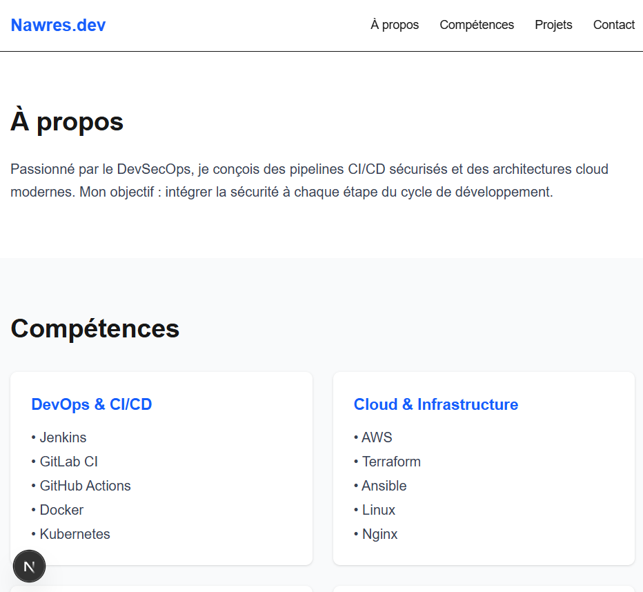
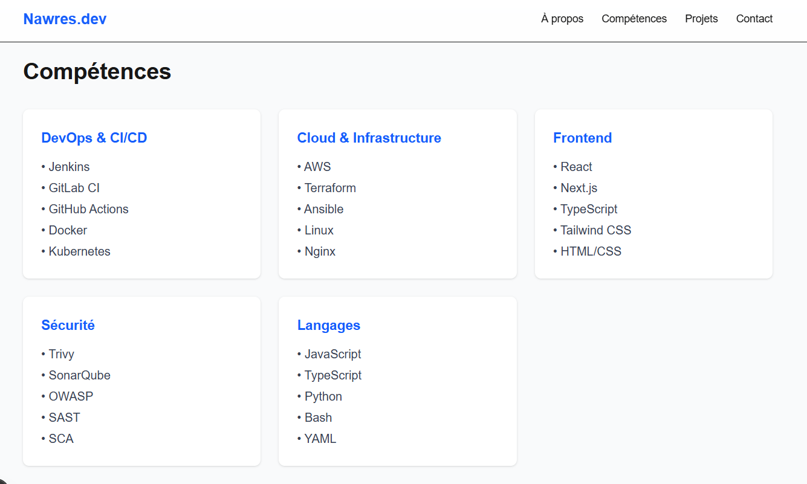
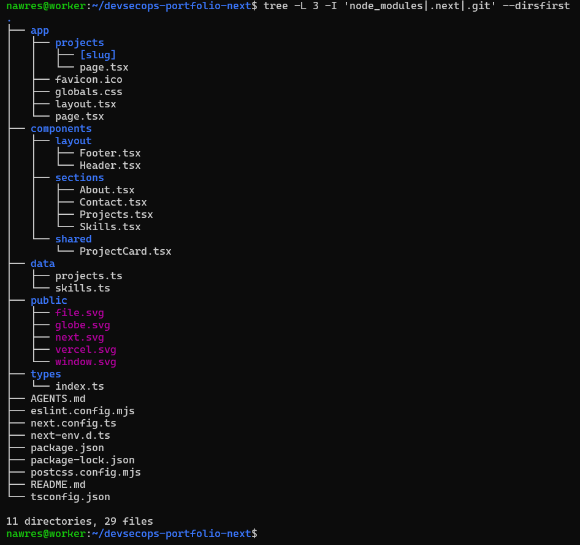
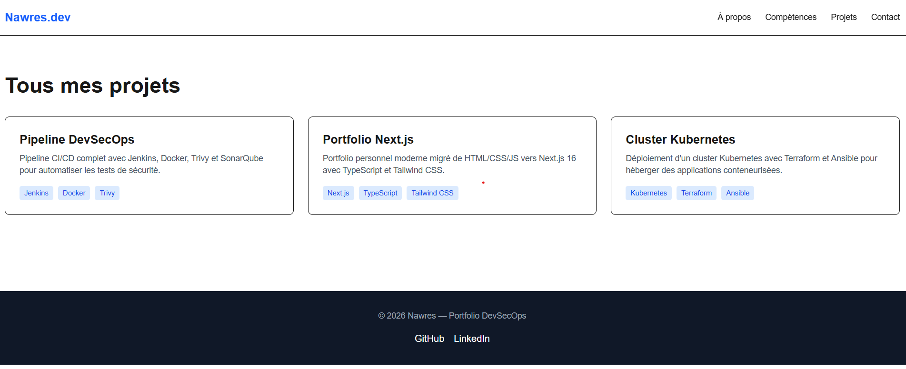
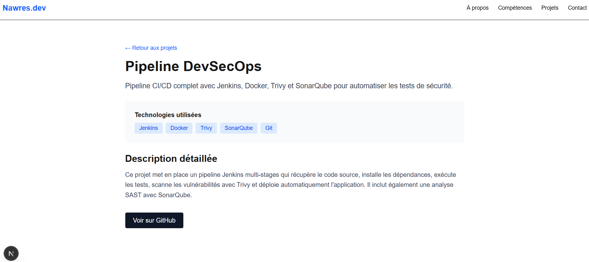
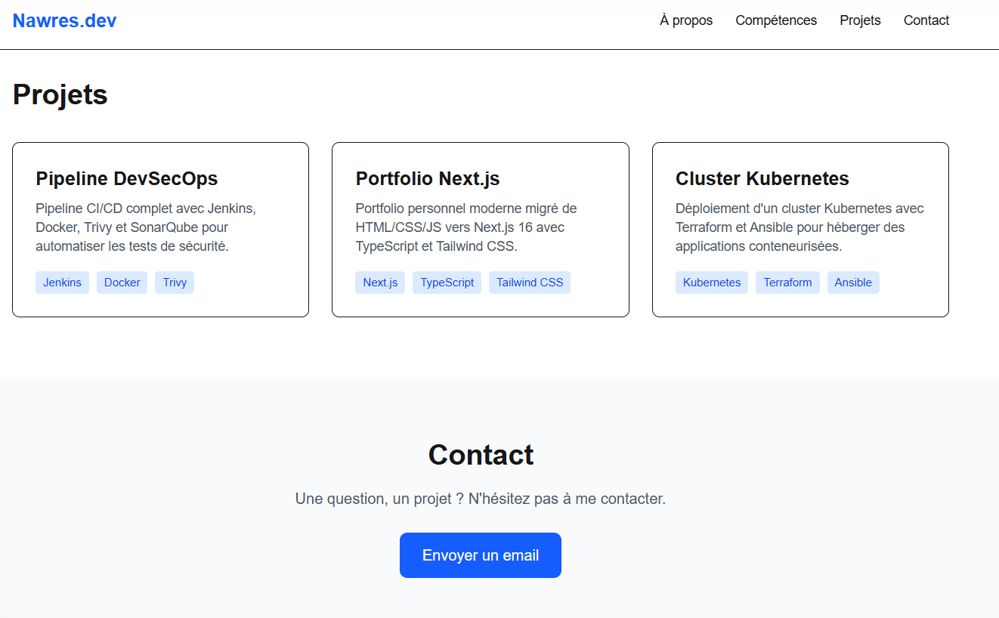
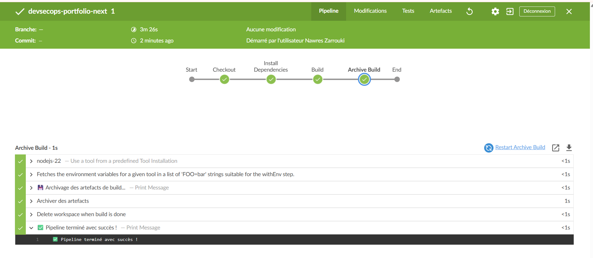
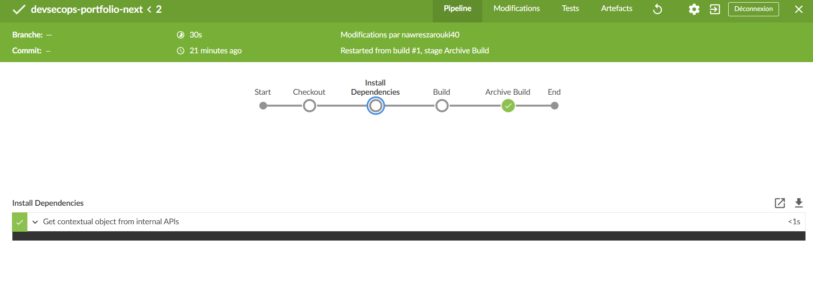

# DevSecOps Portfolio — Next.js

Portfolio personnel développé avec **Next.js 16**, **TypeScript** et **Tailwind CSS**, dans le cadre d'un parcours DevSecOps. Ce projet illustre la migration d'un portfolio HTML/CSS/JS vers une architecture moderne React, avec un pipeline Jenkins automatisé.

---

## 🚀 Création du projet

Le projet a été initialisé avec `create-next-app` :

```bash
npx create-next-app@latest devsecops-portfolio-next --typescript --tailwind --app
```

### Capture de l'application





---

## 🏗️ Structure des composants (Activité 19)

L'application est découpée en composants réutilisables organisés par rôle :

```
components/
├── layout/                    # Structure globale
│   ├── Header.tsx             # Barre de navigation sticky
│   └── Footer.tsx             # Pied de page avec liens sociaux
├── sections/                  # Sections de la page d'accueil
│   ├── About.tsx              # Section "À propos"
│   ├── Skills.tsx             # Grille des compétences
│   ├── Projects.tsx           # Aperçu des projets
│   └── Contact.tsx            # Section de contact
└── shared/                    # Composants réutilisables
    └── ProjectCard.tsx        # Carte projet (utilisée sur / et /projects)
```

### Arborescence complète du projet



Chaque composant est **autonome** et **réutilisable** :
- `Header` et `Footer` sont utilisés sur toutes les pages
- `ProjectCard` est utilisé sur la page d'accueil **et** sur `/projects`
- Les sections sont composées dans `app/page.tsx`

---

## 📊 Données séparées (Activité 20)

Les informations métier sont externalisées dans des fichiers TypeScript dédiés :

| Fichier | Contenu |
|---|---|
| `data/projects.ts` | Liste des projets (slug, titre, description, technologies, liens) |
| `data/skills.ts` | Compétences regroupées par catégorie |
| `types/index.ts` | Interfaces TypeScript (`Project`, `SkillCategory`) |

### Exemple — `data/projects.ts`

```ts
export interface Project {
  slug: string;
  title: string;
  description: string;
  longDescription: string;
  technologies: string[];
  image: string;
  github?: string;
  demo?: string;
}

export const projects: Project[] = [
  {
    slug: "devsecops-pipeline",
    title: "Pipeline DevSecOps",
    description: "Pipeline CI/CD complet avec Jenkins, Docker, Trivy et SonarQube.",
    longDescription: "Ce projet met en place un pipeline Jenkins multi-stages...",
    technologies: ["Jenkins", "Docker", "Trivy", "SonarQube", "Git"],
    image: "/images/projects/devsecops-pipeline.png",
    github: "https://github.com/nawres/devsecops-pipeline",
  },
  // ...
];
```

### Capture — Exemple de données dans l'éditeur


---

## 🔗 Pages dédiées (Activité 21)

L'application expose 3 routes principales :

| Route | Description | Type |
|---|---|---|
| `/` | Portfolio principal (About, Skills, Projects, Contact) | Static (○) |
| `/projects` | Liste complète de tous les projets | Static (○) |
| `/projects/[slug]` | Détail dynamique d'un projet | SSG (●) |

Les pages dynamiques sont **pré-rendues en HTML statique** via `generateStaticParams`.

### Capture — Liste complète des projets



### Capture — Détail d'un projet





---

## 🔧 Premier pipeline Jenkins (Activités 22-24)

### Objectif

Automatiser :
1. La **récupération** du dépôt GitHub
2. L'**installation** des dépendances npm
3. Le **build** de l'application Next.js
4. L'**archivage** des artefacts

### Jenkinsfile

```groovy
pipeline {
    agent any

    tools {
        nodejs 'nodejs-22'
    }

    stages {
        stage('Checkout') {
            steps {
                echo '📥 Récupération du dépôt GitHub...'
                checkout scm
                sh 'git log -1 --oneline'
            }
        }

        stage('Install Dependencies') {
            steps {
                echo '📦 Installation des dépendances npm...'
                sh 'npm install --no-audit --no-fund'
            }
        }

        stage('Build') {
            steps {
                echo '🏗️ Build de l\'application Next.js...'
                sh 'npm run build'
            }
        }

        stage('Archive Build') {
            steps {
                archiveArtifacts artifacts: '.next/**/*', fingerprint: true, allowEmptyArchive: true
            }
        }
    }

    post {
        success { echo '✅ Pipeline terminé avec succès !' }
        failure { echo '❌ Le pipeline a échoué.' }
        always  { cleanWs() }
    }
}
```

### Configuration `.npmrc` (contournement des timeouts réseau)

```ini
audit=false
fund=false
fetch-retries=5
fetch-retry-mintimeout=20000
fetch-retry-maxtimeout=120000
fetch-timeout=300000
```

### Résultat du pipeline (Stage View)

Pipeline exécuté avec succès en **3m 26s** — 4 stages verts :



### Logs des stages Install + Build



---

## 🛠️ Stack technique

| Catégorie | Technologies |
|---|---|
| **Framework** | Next.js 16.4.1 (App Router, Turbopack) |
| **Langage** | TypeScript 5 |
| **UI** | React 19, Tailwind CSS v4 |
| **Qualité** | ESLint 9 |
| **CI/CD** | Jenkins (service systemd) |
| **Outils** | Git, Node.js 22 |

---

## 📦 Installation et lancement

```bash
# Cloner le dépôt
git clone https://github.com/nawreszr/devsecops-portfolio-next.git
cd devsecops-portfolio-next

# Installer les dépendances
npm install

# Développement
npm run dev
# → http://localhost:3000

# Production
npm run build && npm start
```

---

## 👤 Auteur

**Nawres Zarrouki** — Portfolio DevSecOps

- GitHub : [@nawreszr](https://github.com/nawreszr)
